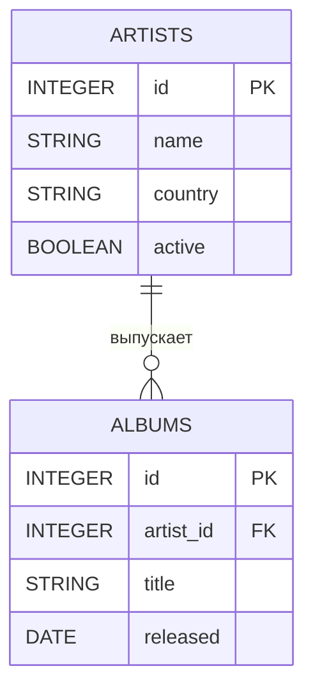
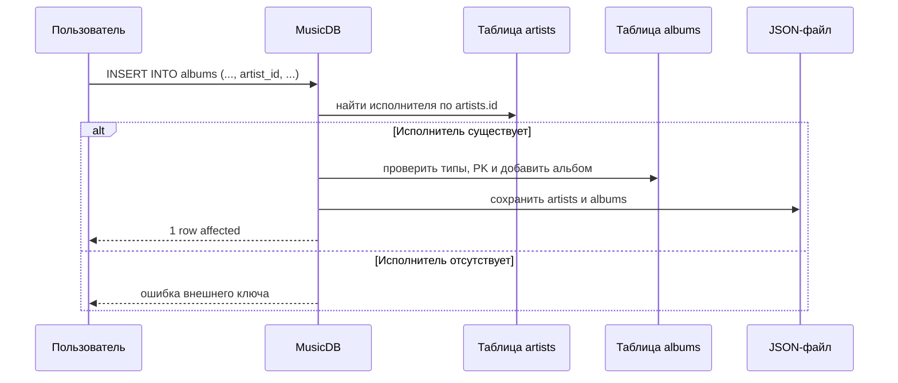

# Лабораторные работы по Java

**HSE 25CST2**

В данном репозитории собраны все лабораторные работы по курсу Java.

---

## Лабораторная №1

📁 `/lab1`

Необходимо создать базовые классы комплексных чисел и матрицы.

### Реализовано

#### 1. Класс комплексных чисел

* Действительная и мнимая часть
* Методы `set` и `get`
* Основные арифметические методы
* Красивый вывод в консоль

#### 2. Класс Матрицы

* Конструктор создания квадратичной матрицы комплексных чисел по заданному размеру
* Методы `get` и `set` для элементов
* Нахождение `Determinant`, `Minor`, `Transposition`
* Арифметические методы сложения, умножения, вычитания и деления
* Красивый вывод в консоль

#### 3. Main

* Основной вход в программу
* Дополнительные функции для красивого вывода в консоль
* Обработка ошибок

---

## Лабораторная №2

📁 `/lab2`

Упрощённая система управления базами данных с консольным SQL-подобным интерфейсом. Предметная область — музыкальная коллекция.

## Возможности

- таблицы со схемой и одним первичным ключом;
- типы `INTEGER`, `DOUBLE`, `STRING`, `DATE`, `BOOLEAN`;
- внешние ключи `REFERENCES table(column)`;
- сериализация базы в JSON и загрузка при запуске;
- `INSERT`, `SELECT`, `UPDATE`, `DELETE`, `CREATE TABLE`, `DROP TABLE`, `CREATE INDEX`;
- проверка типов, `NOT NULL`, уникальности первичного ключа и внешних ключей;
- откат изменений при ошибке операции или сохранения;
- индексы `HashMap` для условий равенства;
- табличный вывод результатов запросов.

## Архитектура

| Компонент | Назначение |
|---|---|
| `Main` | консольный цикл и табличный вывод |
| `QueryParser` | токенизация и разбор SQL-подобных команд |
| `Database` | таблицы, внешние ключи, операции и сохранение |
| `Table` | схема, строки, CRUD, первичный ключ и индексы |
| `Column`, `Row` | столбец и запись |
| `DataType` | типы и преобразование значений |
| `Condition` | сравнение в `WHERE` |
| `JsonStorageManager` | чтение и атомарная запись JSON |



Диаграмма отражает используемую предметную область: один исполнитель может иметь много альбомов, а каждый альбом ссылается на одного исполнителя через `albums.artist_id`.



## Сборка и запуск

Требуются JDK 8+ и Maven.

```bash
mvn clean test
mvn compile
java -cp "target/classes;путь/к/gson-2.10.1.jar" Main
```

В Linux/macOS вместо `;` используется `:`. Можно также запустить `Main.main` из IDE. По умолчанию используется `data/music.json`; другой путь передаётся первым аргументом.

## Команды

```sql
CREATE TABLE artists (id INTEGER PRIMARY KEY, name STRING NOT NULL, country STRING, active BOOLEAN);
CREATE TABLE albums (id INTEGER PRIMARY KEY, artist_id INTEGER REFERENCES artists(id), title STRING NOT NULL, released DATE);
INSERT INTO artists VALUES (1, 'Dora', 'USA', TRUE);
INSERT INTO artists (id, name) VALUES (2, 'O''Brien');
INSERT INTO albums (id, artist_id, title, released) VALUES (1, 1, 'First', '2026-01-01');
SELECT * FROM artists;
SELECT name, country FROM artists WHERE id >= 1;
UPDATE artists SET country = 'UK' WHERE id = 2;
DELETE FROM albums WHERE id = 1;
CREATE INDEX idx_artists_country ON artists(country);
DROP TABLE albums;
SHOW TABLES
HELP
EXIT
```

Точка с запятой необязательна. Поддерживаются операторы `=`, `!=`, `<>`, `>`, `<`, `>=`, `<=` и один предикат `WHERE`. `NULL` обозначает отсутствие значения. `JOIN`, `AND`, `OR` и `ORDER BY` не входят в минимальное подмножество.

Для `INSERT` поддерживаются оба варианта:

```sql
INSERT INTO cars VALUES (1, 'Toyota', 25000.0, TRUE);
INSERT INTO cars (id, brand) VALUES (2, 'BMW');
```

Без списка столбцов значения идут в порядке столбцов таблицы.

## Индексы

`CREATE INDEX idx_cars_brand ON cars(brand);` создаёт `HashMap`-индекс. Индекс сохраняется в JSON и восстанавливается при запуске. Для `WHERE indexed_column = value` используется индекс; диапазонные операторы выполняют последовательный просмотр строк.

## Тестирование

`test/DatabaseTest.java` проверяет CRUD, типы данных, SQL-команды, первичный и внешний ключи, сохранение/загрузку, откат после ошибок и жизненный цикл индексов.

```bash
mvn clean test
```

Для производительности есть `src/Benchmark.java`. Он сравнивает 100 запросов равенства для 1 000, 10 000 и 100 000 строк:

```bash
java -cp "target/classes;путь/к/gson-2.10.1.jar" Benchmark
```

| Строк | Без индекса, ns | С индексом, ns | Ускорение |
|---:|---:|---:|---:|
| 1 000 | _заполнить_ | _заполнить_ | _рассчитать_ |
| 10 000 | _заполнить_ | _заполнить_ | _рассчитать_ |
| 100 000 | _заполнить_ | _заполнить_ | _рассчитать_ |

## Участники и зоны ответственности

| Участник | Группа | Зона ответственности |
|---|---|---|
| _Ромодин Егор_ | _25КНТ2_ | _Индексы, оптимизация и производительность_ |
| _Шемаров Денис_ | _25КНТ2_ | _Ядро СУБД и хранение данных_ |
| _Шевченко Станислав_ | _25КНТ2_ | _SQL-парсер и консольный интерфейс_ |

## Итог

Разработана учебная СУБД с JSON-хранилищем, типизированными таблицами, первичными и внешними ключами, SQL-подобным интерфейсом и индексами для запросов равенства. Реализованы базовые операции СУБД и восстановление данных при следующем запуске. Индексы уменьшают объём просмотра строк для точечных запросов, а диапазонные условия пока обрабатываются последовательным поиском.

## Источники

1. Java Platform SE 8 API — https://docs.oracle.com/javase/8/docs/api/
2. Maven Documentation — https://maven.apache.org/guides/
3. Лекционные материалы
