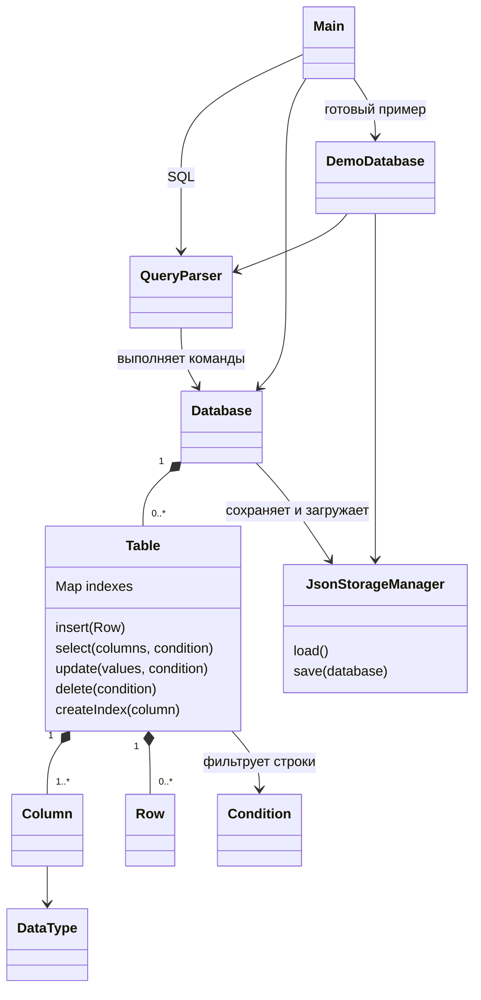
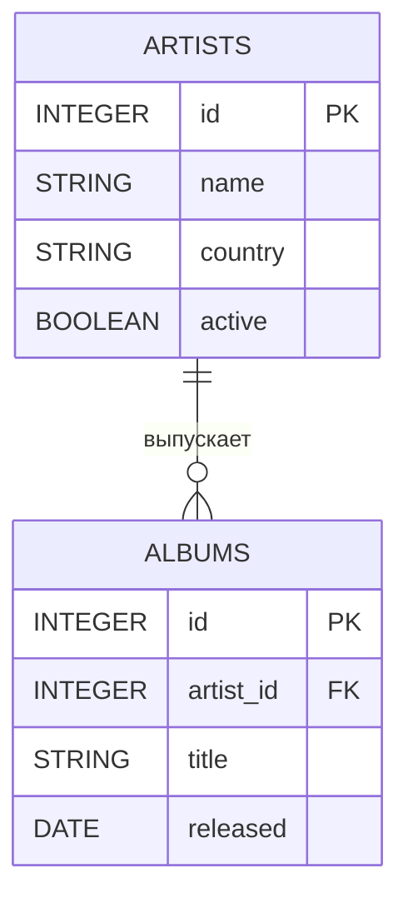
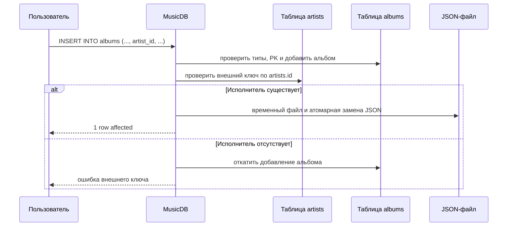

# Лабораторные работы по Java

**HSE 25CST2**

В данном репозитории собраны все лабораторные работы по курсу Java.

---

## Лабораторная №1

📁 `/lab1`

Необходимо создать базовые классы комплексных чисел и матрицы.

### Реализовано

#### 1. Класс комплексных чисел

* Действительная и мнимая часть
* Методы `set` и `get`
* Основные арифметические методы
* Красивый вывод в консоль

#### 2. Класс Матрицы

* Конструктор создания квадратичной матрицы комплексных чисел по заданному размеру
* Методы `get` и `set` для элементов
* Нахождение `Determinant`, `Minor`, `Transposition`
* Арифметические методы сложения, умножения, вычитания и деления
* Красивый вывод в консоль

#### 3. Main

* Основной вход в программу
* Дополнительные функции для красивого вывода в консоль
* Обработка ошибок

---

## Лабораторная №2

📁 `/lab2`

Упрощённая система управления базами данных с консольным SQL-подобным интерфейсом. Предметная область - музыкальная коллекция.

## Возможности

- таблицы со схемой и одним первичным ключом;
- типы `INTEGER`, `DOUBLE`, `STRING`, `DATE`, `BOOLEAN`;
- внешние ключи `REFERENCES table(column)`;
- сериализация базы в JSON и загрузка при запуске;
- `INSERT`, `SELECT`, `UPDATE`, `DELETE`, `CREATE TABLE`, `DROP TABLE`, `CREATE INDEX`;
- проверка типов, `NOT NULL`, уникальности первичного ключа и внешних ключей;
- откат изменений при ошибке операции или сохранения;
- индексы `HashMap` для условий равенства;
- табличный вывод результатов запросов.

## Архитектура

| Компонент | Назначение |
|---|---|
| `Main` | выбор начальной базы, консольный цикл и табличный вывод |
| `DemoDatabase` | создание готового музыкального примера в пустом хранилище |
| `QueryParser` | токенизация и разбор SQL-подобных команд |
| `Database` | таблицы, внешние ключи, операции и сохранение |
| `Table` | схема, строки, CRUD, первичный ключ и индексы |
| `Column`, `Row` | столбец и запись |
| `DataType` | типы и преобразование значений |
| `Condition` | сравнение в `WHERE` |
| `JsonStorageManager` | чтение и атомарная запись JSON |





Диаграмма отражает используемую предметную область: один исполнитель может иметь много альбомов, а каждый альбом ссылается на одного исполнителя через `albums.artist_id`.



## Сборка и запуск

Требуются JDK 8+ и Maven.

```bash
mvn clean test
mvn compile
java -cp "target/classes;путь/к/gson-2.10.1.jar" Main
```

В Linux/macOS вместо `;` используется `:`. Можно также запустить `Main.main` из IDE. По умолчанию используется `data/music.json`; другой путь передаётся первым аргументом.

## Готовая музыкальная база по выбору

Если база пустая, при запуске можно выбрать `1` для готового примера или `2` (либо Enter) для пустой базы. Выбор работает также при запуске из IDE. Существующая база открывается без вопроса и повторного наполнения.

Для запуска без вопроса используйте флаг:

```bash
java -cp "target/classes;путь/к/gson-2.10.1.jar" Main --demo
java -cp "target/classes;путь/к/gson-2.10.1.jar" Main --empty
java -cp "target/classes;путь/к/gson-2.10.1.jar" Main data/demo.json --demo
```

В macOS/Linux разделитель classpath - `:`. Для передачи SQL через стандартный ввод в пустую базу укажите `--empty`, чтобы пропустить выбор. Флаг `--empty` открывает существующие данные, если они есть; он не очищает файл. Флаг `--demo` также не заменяет существующие таблицы. Чтобы получить отдельный готовый пример, укажите новый путь, например `data/demo.json`.

Готовый пример содержит таблицы `artists` (3 исполнителя) и `songs` (6 записей песен), связанные через `songs.artist_id REFERENCES artists(id)`. В `artists` добавлены Дора, Тёмный принц и madk1d; страна - Россия. Песни добавлены для двух последних исполнителей:

| Исполнитель | Песни |
|---|---|
| Тёмный принц | Malo 2.0; ты че обиделась; Jealous |
| madk1d | ДИНАСТИЯ; 8 миля; так по*** |

Поля `collaborators` и `popularity_rank` содержат соисполнителей и позицию в выбранной тройке. Название `так по***` сохранено в написании источника. Это первые три позиции списков популярных треков MusicTracker по данным Яндекс Музыки, проверенные 14.11.2026: [Тёмный принц](https://musictracker.ru/artist/ym-23300354), [madk1d](https://musictracker.ru/artist/ym-13992820). Рейтинг зависит от площадки и времени; программа хранит этот набор, а не обновляет чарт онлайн.

При создании готового примера автоматически создаётся индекс `songs.artist_id`. Данные сначала собираются в памяти и сохраняются одним вызовом хранилища. После запуска можно выполнять:

```sql
SELECT * FROM artists;
SELECT title, collaborators FROM songs WHERE artist_id = 2;
SELECT title FROM songs WHERE artist_id = 3;
```

## Команды

```sql
CREATE TABLE artists (id INTEGER PRIMARY KEY, name STRING NOT NULL, country STRING, active BOOLEAN);
CREATE TABLE albums (id INTEGER PRIMARY KEY, artist_id INTEGER REFERENCES artists(id), title STRING NOT NULL, released DATE);
INSERT INTO artists VALUES (1, 'Дора', 'Россия', TRUE);
INSERT INTO artists (id, name) VALUES (2, 'O''Brien');
INSERT INTO albums (id, artist_id, title, released) VALUES (1, 1, 'First', '2026-01-01');
SELECT * FROM artists;
SELECT name, country FROM artists WHERE id >= 1;
UPDATE artists SET country = 'UK' WHERE id = 2;
DELETE FROM albums WHERE id = 1;
CREATE INDEX idx_artists_country ON artists(country);
DROP TABLE albums;
SHOW TABLES
HELP
EXIT
```

Точка с запятой необязательна. Поддерживаются операторы `=`, `!=`, `<>`, `>`, `<`, `>=`, `<=` и один предикат `WHERE`. `NULL` обозначает отсутствие значения. `JOIN`, `AND`, `OR` и `ORDER BY` не входят в минимальное подмножество.

Для `INSERT` поддерживаются оба варианта:

```sql
INSERT INTO artists VALUES (1, 'Дора', 'Россия', TRUE);
INSERT INTO artists (id, name) VALUES (2, 'O''Brien');
```

Без списка столбцов значения идут в порядке столбцов таблицы.

Связь исполнителей и альбомов задаётся внешним ключом `albums.artist_id REFERENCES artists(id)` (схема приведена в разделе «Команды»). Вставка альбома с несуществующим исполнителем, удаление исполнителя с альбомами и изменение его используемого ключа отклоняются.

## Индексы

`CREATE INDEX idx_artists_country ON artists(country);` создаёт `HashMap`-индекс. В JSON сохраняется список индексируемых столбцов; сами HashMap-индексы перестраиваются из строк при запуске. Для `WHERE indexed_column = value` используется индекс; диапазонные операторы выполняют последовательный просмотр строк.

## Тестирование

`test/DemoDatabaseTest.java` проверяет наполнение готовой базы, выбор режима запуска, сохранение изменений и защиту существующих данных.

`test/DatabaseTest.java` проверяет CRUD, типы данных, SQL-команды, первичный и внешний ключи, сохранение/загрузку, откат после ошибок и жизненный цикл индексов.

```bash
mvn clean test
```

Результат проверки 14.11.2026 (Zulu OpenJDK 8u452, Maven 3.9.9): **BUILD SUCCESS**, тестов - **18**, ошибок - **0**, падений - **0**, пропущенных - **0**.

Для производительности есть `src/Benchmark.java`. Он сравнивает 100 запросов равенства для 1 000, 10 000 и 100 000 строк:

```bash
java -cp "target/classes;путь/к/gson-2.10.1.jar" Benchmark
```

Замер: macOS 26.3, ARM64, Zulu OpenJDK 8u452, Gson 2.10.1, 14.11.2026. Один запуск исходного `Benchmark` без прогрева JVM. Время в таблице - сумма 100 SELECT через Java API, а не время одного запроса. Для каждого размера генерируются 100 равномерно повторяющихся значений artist: один запрос возвращает 1% строк. Создание таблиц, вставка, построение индекса и дисковый ввод-вывод в замер не входят. Ускорение = время без индекса / время с индексом; результаты зависят от JVM и нагрузки.

Для macOS/Linux с обычным локальным репозиторием Maven:

```bash
java -cp "target/classes:$HOME/.m2/repository/com/google/code/gson/gson/2.10.1/gson-2.10.1.jar" Benchmark
```

| Строк | Без индекса, ns | С индексом, ns | Ускорение |
|---:|---:|---:|---:|
| 1 000 | 6 978 250 | 317 417 | 21.98× |
| 10 000 | 27 478 584 | 1 022 417 | 26.88× |
| 100 000 | 191 910 125 | 8 199 667 | 23.40× |

## Проверка соответствия ТЗ

Проверка исходников и тестов выполнена 14.11.2026.

| Требование | Состояние и реализация |
|---|---|
| Модели Database, Table, Column, Row | Реализованы в одноимённых классах |
| Пять типов и проверка значений | `DataType`: INTEGER, DOUBLE, STRING, DATE, BOOLEAN; нормализация в `Table` |
| Первичный ключ и уникальность | Один обязательный PK на таблицу; проверка INSERT и UPDATE |
| Внешний ключ albums → artists | `albums.artist_id REFERENCES artists(id)`; JUnit проверяет ограничения и восстановление связи после загрузки |
| Добавление, обновление, удаление через API | `Database.insert`, `update`, `delete`; откат при нарушении ограничений или ошибке сохранения |
| JSON и восстановление при запуске | `JsonStorageManager`, подключение хранилища в `Main` |
| Временный файл и атомарная замена | `ATOMIC_MOVE` с переходом на обычную замену, если атомарная операция не поддерживается |
| JUnit для ядра и хранилища | `test/DatabaseTest.java`, включая загрузку и ошибку сохранения |
| SQL: INSERT, SELECT, UPDATE, DELETE, CREATE TABLE, DROP TABLE | Реализованы в `QueryParser` |
| WHERE: =, !=, >, <, >=, <= | Все шесть операторов реализованы; также есть `<>` |
| SELECT * и отдельные столбцы | Реализованы |
| Несколько строк в INSERT | Реализовано и проверяется JUnit |
| Консоль, табличный вывод и ошибки синтаксиса | `Main`, `QueryParser`; ошибки парсера содержат позицию токена |
| Тесты парсера и выполнения | Есть в `DatabaseTest`; отдельного теста консольного форматирования нет |
| HashMap-индекс и CREATE INDEX | Реализованы в `Table` и `QueryParser` |
| Индекс для SELECT WHERE column = value | Используется для EQ, включая NULL |
| Актуализация после INSERT, UPDATE, DELETE | INSERT дополняет индекс, UPDATE/DELETE перестраивают; есть JUnit-тест |
| Сохранение и восстановление индексов | Сохраняются определения, HashMap перестраивается при загрузке; есть JUnit-тест |
| Генератор тестовых данных | Встроен в `Benchmark.main`: id и 100 повторяющихся значений artist; отдельного генератора/экспорта нет |
| Замеры 1 000 / 10 000 / 100 000 строк | Результаты приведены выше |
| Диаграммы классов и последовательностей | Приведены в разделе архитектуры; дополнительно есть ER-диаграмма |
| README и результаты тестирования | Приведены в этом документе |

При проверке исправлены две ошибки: загрузка таблицы с индексом завершалась `NullPointerException` из-за отсутствия инициализированных HashMap, а поиск `WHERE column = NULL` после создания индекса терял строки. Добавлен регрессионный JUnit-тест для NULL после INSERT, UPDATE, DELETE и повторной загрузки.

Связь `albums.artist_id REFERENCES artists(id)` проверяется JUnit-тестом: отклоняются несуществующий внешний ключ, удаление исполнителя с альбомами, изменение его ключа и удаление связанной таблицы; проверяется восстановление из JSON. Все перечисленные функциональные пункты ТЗ представлены в реализации и документации; генератор музыкальных тестовых данных реализован внутри benchmark.

## Участники и зоны ответственности

| Участник | Группа | Зона ответственности |
|---|---|---|
| _Ромодин Егор_ | _25КНТ2_ | _Индексы, оптимизация и производительность_ |
| _Шемаров Денис_ | _25КНТ2_ | _Ядро СУБД и хранение данных_ |
| _Шевченко Станислав_ | _25КНТ2_ | _SQL-парсер и консольный интерфейс_ |

## Итог

Разработана учебная СУБД с JSON-хранилищем, типизированными таблицами, первичными и внешними ключами, SQL-подобным интерфейсом и индексами для запросов равенства. Реализованы базовые операции СУБД и восстановление данных при следующем запуске. Индексы уменьшают объём просмотра строк для точечных запросов, а диапазонные условия пока обрабатываются последовательным поиском.

## Источники

1. Java Platform SE 8 API - https://docs.oracle.com/javase/8/docs/api/
2. Maven Documentation - https://maven.apache.org/guides/
3. Лекционные материалы
