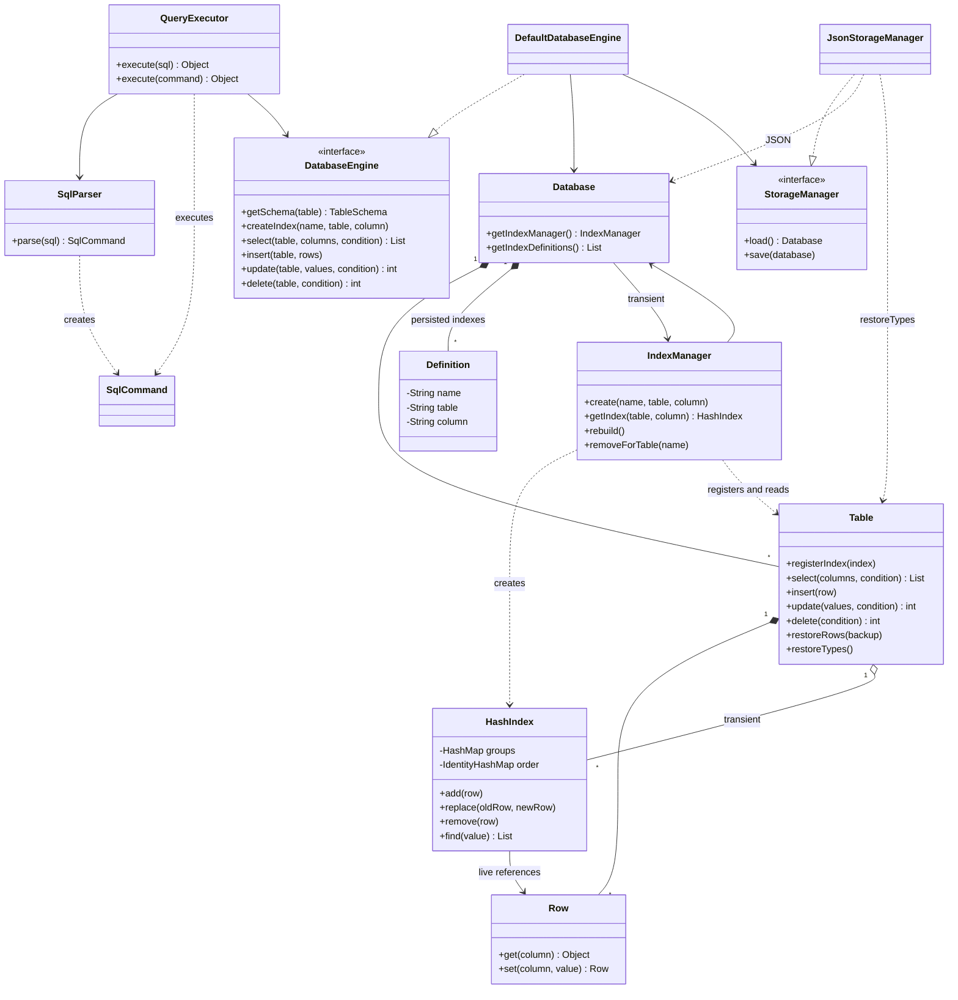
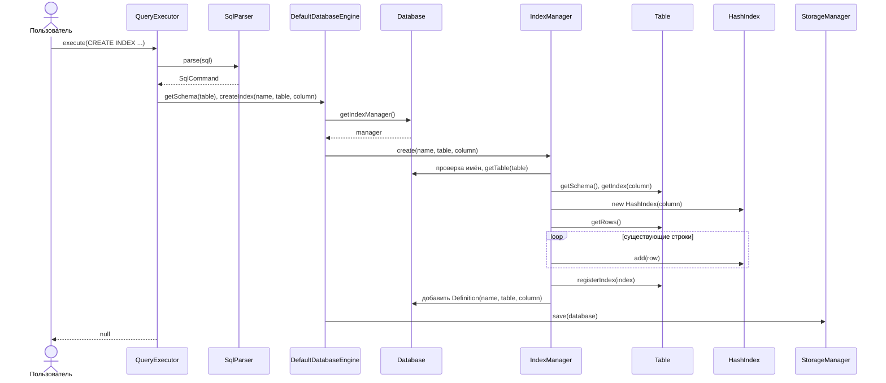
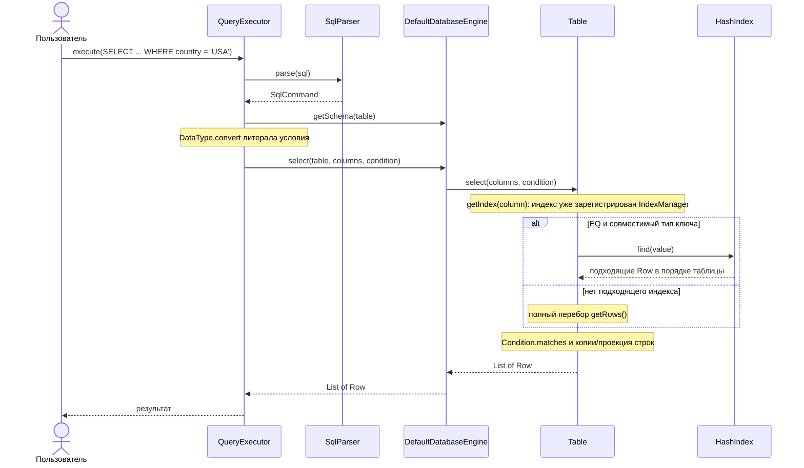
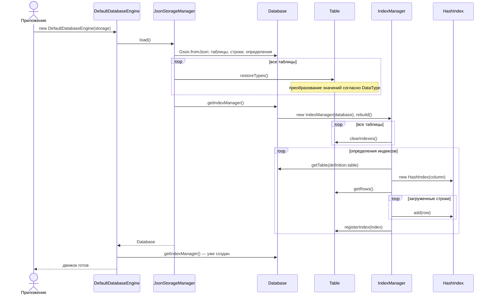

# Индексы: диаграммы фактической реализации

Определения хранятся в Database, менеджер создаёт и регистрирует HashIndex на Table.
Поиск и обновление ссылок выполняет Table, поэтому SQL не дублирует CRUD ядра.

## Классы



## Создание индекса



## SELECT с индексом



## INSERT, UPDATE и DELETE

```mermaid
sequenceDiagram
    actor User as Пользователь
    participant Q as QueryExecutor
    participant P as SqlParser
    participant E as DefaultDatabaseEngine
    participant T as Table
    participant H as HashIndex
    participant S as StorageManager
    User->>Q: execute(INSERT / UPDATE / DELETE)
    Q->>P: parse(sql)
    P-->>Q: SqlCommand
    Q->>E: CRUD(table, ...)
    Note over E: резервный список прежних Row
    alt INSERT
        E->>E: преобразование типов, проверка FK
        E->>T: insert(row)
        Note over T: нормализация, проверка PK, добавление Row
        T->>H: add(сохранённый Row) для каждого индекса
    else UPDATE
        E->>T: update(values, condition)
        Note over T: старые Row сохранены, новые Row нормализованы, PK проверен
        loop изменённые строки и все индексы
            T->>H: replace(oldRow, newRow)
            Note over H: прежний ключ — замена ссылки; новый — перенос группы
        end
        E->>E: проверка FK
    else DELETE
        E->>E: проверка ссылок других таблиц
        E->>T: delete(condition)
        loop удаляемые строки и все индексы
            T->>H: remove(row)
            Note over H: удалить пустую группу
        end
    end
    E->>S: save(database)
    alt ошибка изменения / сохранения
        E->>T: restoreRows(backup)
        Note over T,H: восстановление строк и перестройка индексов
        E-->>Q: исключение
    else успех
        E-->>Q: результат CRUD
        Q-->>User: число строк
    end
```

## Загрузка и восстановление


